import { Aside, Badge, CardGrid, Code, Steps, FileTree, LinkButton } from '@astrojs/starlight/components';

export const exampleCode = `VisionPortal portal = new VisionPortal.Builder()
    .setCamera(webcamName)
    .setCameraResolution(new Size(1280, 720))
    .addProcessor(baller)
    .enableLiveView(true)
    .build();`;

export const fileName = 'HiveVisionOpmode.java';
export const highlights = ['VisionPortal', 'addProcessor', 'enableLiveView'];

{/* 50/50 Grid Hero Container */}

  {/* LEFT COLUMN: Hero content, status pills, text, glowing code block, and buttons */}
  

    

      
        
        FTC Vision Ecosystem
      
      Limelight 3A & Webcam Ready
    

    <h1 class="gradient-hero-title">Hive Vision</h1>

    

      An optimized, easy-to-use computer vision library tailored for FIRST Tech Challenge, built for your camera choice with co-processor AI & real-time color tracking.
    

    

      <Code code={exampleCode} lang="java" title={fileName} mark={highlights} />
    

    

      <LinkButton href="/overview/overview" variant="minimal" icon="external">
        Read the docs
      </LinkButton>
      <LinkButton href="/overview/aboutus" variant="secondary" icon="external">
        About Us
      </LinkButton>
      <LinkButton href="https://discord.gg/D42uBwKPwb" variant="minimal" icon="discord">
        Join our discord
      </LinkButton>
    

  

  {/* RIGHT COLUMN: Floating glowing logo */}
  

    

      
    

  

{/* FEATURE HIGHLIGHTS BAR */}

  

    
100% Offloaded

    
Zero Control Hub CPU overhead via Limelight 3A coprocessor neural net.

  

  

    
Sub-30ms

    
Real-time object bounding boxes for yellow pollen, red nectar, & blue nectar.

  

  

    
PedroPathing

    
Instant Bezier trajectory splines automatically driven from field target poses.

  

  

    
OpenCV & TFLite

    
Flexible backends supporting SSD MobileNet V2 and Control Hub HSV color thresholding.

  

---

  <h2 class="glowing-section-title">Neural Networking & Live Detection</h2>
  
Real-time inference feeds, target tracking, and autonomous field pathing in action.

<CardGrid>
  

    

      ⚡ Neural Network Detection
      <Badge text="Limelight 3A SSD MobileNet V2" variant="note" />
    

    <video autoPlay loop muted playsInline width="100%" style={{ display: 'block', objectFit: 'cover' }}>
      <source src="/detection.mp4" type="video/mp4" />
      Your browser does not support the video tag.
    </video>
  

  

    

      🎯 Live Field Pathing & Splines
      <Badge text="PedroPathing Integration" variant="success" />
    

    <video autoPlay loop muted playsInline width="100%" style={{ display: 'block', objectFit: 'cover' }}>
      <source src="/arush.mp4" type="video/mp4" />
      Your browser does not support the video tag.
    </video>
  

</CardGrid>

